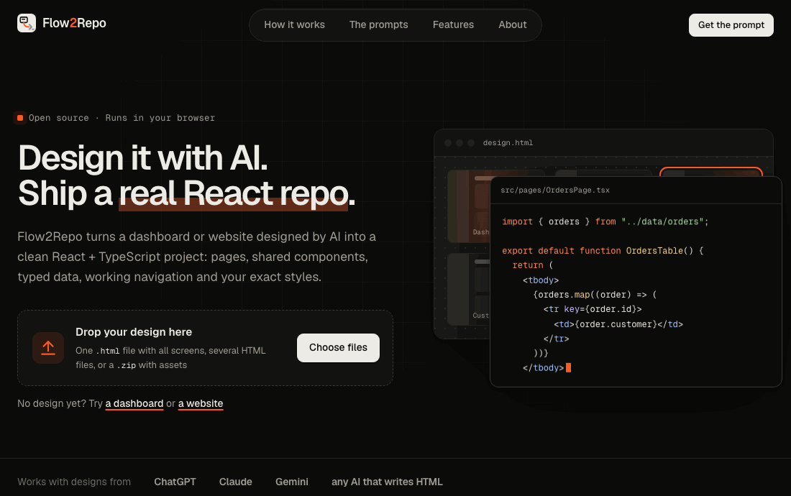

<p align="center">
  
</p>

<h1 align="center">Flow2Repo</h1>

<p align="center">
  <strong>Design it with AI. Ship a real React repo.</strong><br>
  Turn dashboards and websites designed with ChatGPT, Claude or Gemini into clean React + TypeScript projects.
</p>

<p align="center">
  <a href="https://flow2repo.laithalallaf.com"><strong>Try it live →</strong></a>
  &nbsp;·&nbsp;
  <a href="docs/prompts">The prompts</a>
  &nbsp;·&nbsp;
  <a href="#the-story">The story</a>
  &nbsp;·&nbsp;
  <a href="CONTRIBUTING.md">Contribute</a>
</p>

<p align="center">
  <a href="https://github.com/laithalallaf2000-ux/flow2repo/actions/workflows/ci.yml"></a>
  <a href="LICENSE"></a>
  
  
  
</p>

<p align="center">
  
</p>

## Why Flow2Repo

AI can design a whole app in minutes. Turning that HTML into a real project still takes hours: splitting pages, wiring buttons, extracting the sidebar copied onto every screen, turning cards and tables into data. Flow2Repo does that part.

- **Not a line-by-line translation.** Pages with React Router, shared components with props, repeated items as typed data and `.map()`, forms with state, menus and tabs with `useState`, long landing pages split into sections.
- **Exact, not guessed.** Two fixed prompts (dashboard and website) tell the AI how to structure its design, so the conversion knows where every screen, shared part and link is.
- **Plain code, no AI at conversion time.** The same design always produces the same project, and anything that cannot be converted is listed in a report.
- **Private.** Everything runs in your browser. Your designs never leave your machine.

If Flow2Repo saves you time, a ⭐ helps other designers and developers find it.

## The story

I'm a UX designer. I love the part where an idea becomes an interface: the flows, the spacing, the small details that make a screen feel right.

When AI tools arrived, I found a path I didn't expect: designing directly in HTML and CSS. I could sketch a screen, refine it with AI, and hold a real, clickable page in minutes instead of days. I started designing more, and faster.

But a good-looking HTML file is still not a product. Turning it into React meant splitting pages, wiring every button and rewriting the same sidebar again and again. I learned React and Next.js along the way, and saw how much of that work repeats on every project.

So I built the tool I wanted. Flow2Repo turns those designs into a React website or dashboard quickly, with a structure that scales: sample data lands in its own files, ready to be replaced with real data from a backend, and static sites keep their basic animations as designed. It saves a lot of time, and a lot of figuring out.

One more thing matters to me: not everything has to be AI. AI helped me build this converter, but the converter itself is plain, deterministic code. It reads your markup, understands it, and gives the same result every time, with no AI involved at conversion time. The point is to depend on AI less, not more.

— **MHD Laith ALAllaf**, Design Engineer (UX/UI & Frontend) · [laithalallaf.com](https://laithalallaf.com) · [LinkedIn](https://www.linkedin.com/in/mhdlaithalallaf) · [GitHub](https://github.com/laithalallaf2000-ux)

## How it works

1. **Copy a Flow2Repo prompt**: [docs/prompts/dashboard.md](docs/prompts/dashboard.md) for dashboards and web apps, [docs/prompts/website.md](docs/prompts/website.md) for websites. It tells the AI exactly how to structure the file: every screen marked with `data-screen`, shared parts marked with `data-component`, navigation declared with `data-goto`, interactions declared with `data-toggle` / `data-tab`, canvas-only styles kept in their own block.
2. **Generate the design** with any AI that writes HTML. Describe your app and list its screens.
3. **Drop the file into Flow2Repo.** Review the detected screens, rename titles and routes, choose the start page, preview each screen, read the generated code and download the ZIP.

Designs made without the prompt still work, with more to review:

| Input | How screens are found |
| --- | --- |
| HTML following the prompt | `data-screen` markers (exact) |
| Several HTML files | one screen per file, links between files become routes |
| One HTML file with a board of screens | guessed from the layout, buttons linked by their labels |
| Anything else | the whole file becomes one page |

## What the generated project contains

- `src/pages/*Page.tsx`: one component per screen, plus a scoped `.css` file when the screen has its own styles
- `src/components/*.tsx`: parts repeated across screens (sidebar, top bar, footer…), extracted once. The current-page highlight becomes `NavLink` / route-aware classes, and a sidebar's links come from a typed array
- `src/data/*.ts`: the design's sample data (repeated cards, rows, list items, navigation links) as typed arrays, one file per page or component. Pages render them with `.map()`; to connect a backend, replace the array in that file with a fetch
- `src/types/*.ts`: the interfaces of that data and the value types of the page's forms
- `src/App.tsx`: React Router routes, scroll restoration and a fallback route
- `src/styles/global.css`: the design's shared styles, with canvas-only styles removed
- `public/`: images, fonts and stylesheets from the design
- `README.md`: pages, components and any conversion notes

Folders are only created when they are needed: a page without lists or forms gets no `data/` or `types/` file.

HTML is converted into idiomatic JSX: `className` / `htmlFor`, style objects, camel-cased SVG attributes, controlled form fields, escaped text, and explicit spacing only where whitespace is visible (not between the items of a flex or grid container).

## Beyond a straight translation

- **Repeated items become data + `.map()`.** Three or more sibling elements with the same structure (stat cards, table rows, list items, navigation links) turn into one array and one `.map()`, with fields named after the design: a table column header, a BEM class (`stat__label` → `label`), what the value is (a price, a date, a status, an e-mail address) or the tag. Plain text lists become `string[]`, icons become `ReactNode`, and an item with no natural key gets a generated `id`. Names never collide with React Router or browser globals (`LinkItem`, not `Link`), and a second list with the same name is named after its section (`pricingCards`).
- **Nested lists stay nested.** Tags in a card, features in a plan, links in a footer column, deals in a pipeline column become arrays inside the parent objects, rendered with nested `.map()` calls. Each item can have a different number of entries:

  ```ts
  export interface Product { title: string; tags: string[] }
  export const products: Product[] = [
    { title: "Product A", tags: ["New", "Popular", "Sale"] },
    { title: "Product B", tags: ["Featured"] },
  ];
  ```
- **Data lives in its own layer.** The arrays are written to `src/data/<page>.ts` and their interfaces to `src/types/<page>.ts`; the page imports the data. They hold the sample data from your design; connecting a backend means replacing the array in that one data file with a fetch.
- **Long pages are split into sections.** A page with three or more large sections (`<section>` or a hero) in its `<main>` gets one component per section in `src/sections/` (`HeroSection`, `FaqSection`…), each with its own data and form state. Short pages stay in one file, and a section whose menu or tab controls something outside it stays in its page.
- **Components get props.** When copies of a shared part differ only in a few texts or values (a header showing each page's title), they become one component: `<Header title="Orders" />`. Copies with different markup stay inline and the report says so.
- **Forms get state and a submit boundary.** Text fields, textareas, selects (also `multiple`), checkboxes, checkbox groups and radio groups become controlled inputs backed by one typed values object per form (`useState<SignupFormValues>`), starting from the design's defaults. Names, labels, types, `required` and other validation attributes are kept, so the browser still validates before the submit handler runs. The handler calls `event.preventDefault()` and marks where your API call goes. Nothing is sent: Flow2Repo does not invent URLs, responses or authentication. File and hidden inputs stay uncontrolled.
- **Interactions become React state.** Mark them in the HTML and they are converted to `useState`:

  | Markup | Result |
  | --- | --- |
  | `data-toggle="menu"` on a button, `data-toggle-target="menu"` on the panel, optional `data-close="menu"` | open / close state, an `is-open` class and `aria-expanded`: dropdowns, menus, modals and accordions |
  | `data-tab-group="billing"` + `data-tab="monthly"` on tabs, `data-tab-panel="monthly"` on panels | selected-tab state, an `is-active` class and `hidden` on the other panels |

  The trigger and its target must sit in the same page or component. CSS animations and transitions are kept as they are.
- **Tailwind is installed, not loaded from a CDN.** Designs that use the Tailwind play CDN (v3) get `tailwindcss`, PostCSS and a `tailwind.config.js` built from the design's inline `tailwind.config = {…}`. Designs that use `@tailwindcss/browser` (v4) get `tailwindcss` with the Vite plugin. The CDN script is removed from `index.html`.
- **Scripts from the design are kept, not translated.** Classic scripts (local files, inline code and CDN libraries) and inline `onclick` handlers are carried over and run after each page renders through `src/lib/useDesignScripts.ts`. The report lists them as warnings, because this is a bridge and not React code: move that logic into state and handlers.

## Current limits

Flow2Repo does its best on any HTML, and tells you in the report when it is unsure. Know these before you rely on it:

- **No visual regression test yet.** The generated projects are tested to install, type-check and build, and the generated code is tested for structure, but there is no automated pixel comparison against the original design. The decision to leave out `{" "}` in flex and grid containers rests on reading the design's CSS, not on a rendering test.
- **No browser tests yet.** The generated interactions, forms and the script bridge are checked by reading the generated code, not by clicking through the result in a browser.
- **Scripts are not rewritten into React.** Only the `data-toggle` / `data-tab` markers above become state. Other JavaScript (calculations, `fetch`, charts) runs through the bridge.
- **Lists:** items that contain form fields or shared components are not turned into data. A nested list that is empty in some items is not merged. A navigation item whose active class sits on a wrapper (`<li class="active"><a>`) instead of the link is not put in an array.
- **Props are strings.** Copies that differ in structure are not merged into one component, and a component that takes props can only hold lists whose values are the same in every copy.
- **Forms:** repeated sets of fields (rows of inputs) are not turned into state arrays, and number inputs are kept as strings.
- **Tailwind:** plugins requested on the CDN URL (`?plugins=…`) and configs that use `require(...)` are not carried over, and classes that exist only inside the design's own scripts are not detected. The v4 path is not build-tested yet.
- **The web preview does not load the Tailwind CDN**, so a Tailwind design can look unstyled in the preview while the downloaded project is styled correctly.
- **The prompts in `docs/prompts/` allow interactions, lists and forms as described above, but forbid Tailwind,** because the web preview cannot show it yet.

## Repository layout

```
packages/converter   conversion engine (TypeScript, runs in the browser and Node)
apps/web             the Flow2Repo web app (React + Vite)
docs/prompts/        the Flow2Repo prompts: dashboard.md (apps) and website.md (sites)
fixtures/            designs used as test cases (13: dashboards, CRM, e-commerce admin, forms, RTL, pricing, landing pages, Tailwind…)
```

## Development

Requires Node 20+.

```bash
npm install
npm run dev        # web app at http://localhost:5173
npm test           # converter unit tests
npm run test:e2e   # converts every fixture, then installs and builds each generated project
npm run build      # production build of the web app
```

To add a test case, put a design in `fixtures/<name>/`. The end-to-end test converts it and requires the generated project to type-check and build.

## Roadmap

- [x] React web output
- [x] Repeated items as data + `.map()`, with the data in `src/data/` and its types in `src/types/`
- [x] Nested lists (tags in cards, features in plans, links in footer columns)
- [x] Navigation links from typed data, keeping the active state
- [x] Props for components whose copies differ only in text
- [x] Toggles, menus, modals, accordions and tabs as React state
- [x] Forms with typed state and a submit boundary
- [x] Tailwind installed in the generated project
- [x] Long landing pages split into one component per section
- [ ] Visual regression tests (original screen vs generated page)
- [ ] Browser tests for the design-script bridge and the generated interactions and forms
- [ ] Translate common script patterns into React
- [ ] Prompt update for Tailwind
- [ ] Web preview with Tailwind
- [ ] More real-world designs as fixtures
- [ ] Flutter output

## Contributing

The most useful contribution is a real design that converts badly: open a [conversion bug](https://github.com/laithalallaf2000-ux/flow2repo/issues/new?template=conversion-bug.yml) with the HTML attached. See [CONTRIBUTING.md](CONTRIBUTING.md) to set up the project and add a fixture.

## License

[MIT](LICENSE) © [MHD Laith ALAllaf](https://laithalallaf.com)
